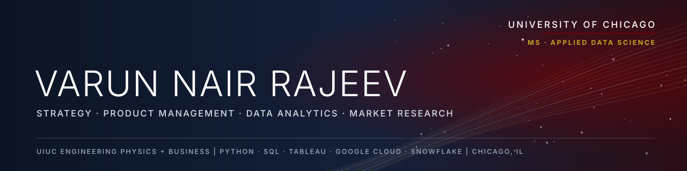

### Strategy & Business Analysis | MS Applied Data Science Candidate, University of Chicago | Engineering Physics, UIUC

I break ambiguous business problems into clear questions, work through them with data, and turn the answers into recommendations people can act on.

I trained as an **engineer (BS, Engineering Physics, minor in Business, UIUC)**. In two summers at **HARTING Technology Group** I worked on revenue, pricing, and market entry decisions, first in market development and then in product management. I'm now pursuing an **MS in Applied Data Science at the University of Chicago**, adding cloud data engineering and statistical modeling to that commercial work. I'm targeting **strategy consulting, business analysis, and market research** roles.

---

## Value delivered

**$180,000 in revenue from distributor stocking packages.** As Product Manager Intern at HARTING, I designed stocking packages for distributors that drove commercial growth.

**A five-year market-share growth strategy for the Director of Marketing.** I researched industrial robotics markets, competitors, and product gaps at HARTING, then turned the findings into go-to-market recommendations.

**Pricing and competitive analysis to inform product launches.** I evaluated adoption metrics and assessed opportunities across the industrial connectivity and EV charging product lines to shape roadmap and positioning.

**Most Outstanding RSO Exhibit, Engineering Open House 2023.** I led i-MADE's cross-functional mechanical team on a design built from physical therapist interviews.

**19K Spotify monthly listeners at peak.** I direct go-to-market campaigns for my own music project, Nayu, and have run digital promotion and performance tracking across 10+ releases.

---

## How I work

| Strategy & business | Analytics & data |
| --- | --- |
| Structure ambiguous problems into testable hypotheses and clear recommendations | Validate data quality before drawing conclusions |
| Market sizing, competitive landscapes, and product-gap analysis | Python and SQL for analysis, from raw tables to insight |
| Pricing analysis and go-to-market planning | Cloud data pipelines on Google Cloud and Snowflake |
| KPI development and performance tracking | Dashboards and reporting in Tableau and Streamlit |
| Stakeholder collaboration, from interns to directors | Statistical modeling for business questions |
| Facilitated product discovery and prioritization workshops | Data-informed storytelling for non-technical audiences |

---

## Focus areas

**Industries I've worked in:** industrial technology · EV charging · industrial robotics · restaurant / consumer analytics · music & the creator economy

---

## Stack

**Analysis & Programming**

**Cloud & Data Platform**

**Visualization & Reporting**

---

## Selected work

**McDonald's Sales Analytics Case, University of Chicago (Fall 2026).** I analyzed restaurant-level sales and revenue patterns, validated data quality, and dug into performance differences between locations to frame business insights.

**Cloud-Native Data Engineering, Sakila Pipeline, University of Chicago (Fall 2026, in progress).** I'm migrating, querying, and analyzing a relational dataset with Python, SQL, Google Cloud, and Snowflake, and building Streamlit reporting on top of it.

**Distributor stocking packages, HARTING (2024).** These product-management packages generated $180K in revenue and came with competitive and pricing analyses for new product launches.

**Industrial robotics market entry, HARTING (2023).** This market, competitor, and product-gap study produced a proposed five-year market-share growth strategy.

---

## Leadership

**Director of Product, Product Management @ Illinois (2022 – 2024).** I led product discovery and prioritization workshops and coordinated relationships with industry mentors to support product management education.

**Mechanical Team Lead, i-MADE, University of Illinois (2022 – 2023).** I led a cross-functional design effort grounded in interviews with physical therapists. The project won Most Outstanding RSO Exhibit at Engineering Open House 2023.

**Independent Artist & Creative Director, Nayu (2023 – present).** I run go-to-market for 10+ releases end to end, covering creative direction, digital promotion, and performance tracking.

---

## Education

**MS, Applied Data Science, University of Chicago** (Sep 2026 – Dec 2027)
Coursework: Leadership & Consulting in Data Science · Statistical Models for Data Science · Cloud-Native Data Engineering

**BS, Engineering Physics; Minor in Business, University of Illinois Urbana-Champaign** (May 2025)

---

## Track record

**University of Chicago** · **HARTING Technology Group** (Product Management, Market Development) · **University of Illinois Urbana-Champaign** · Product Management @ Illinois · i-MADE

I'm an engineer by training who works on the commercial side, using data to help teams decide where to grow and how to get there.
